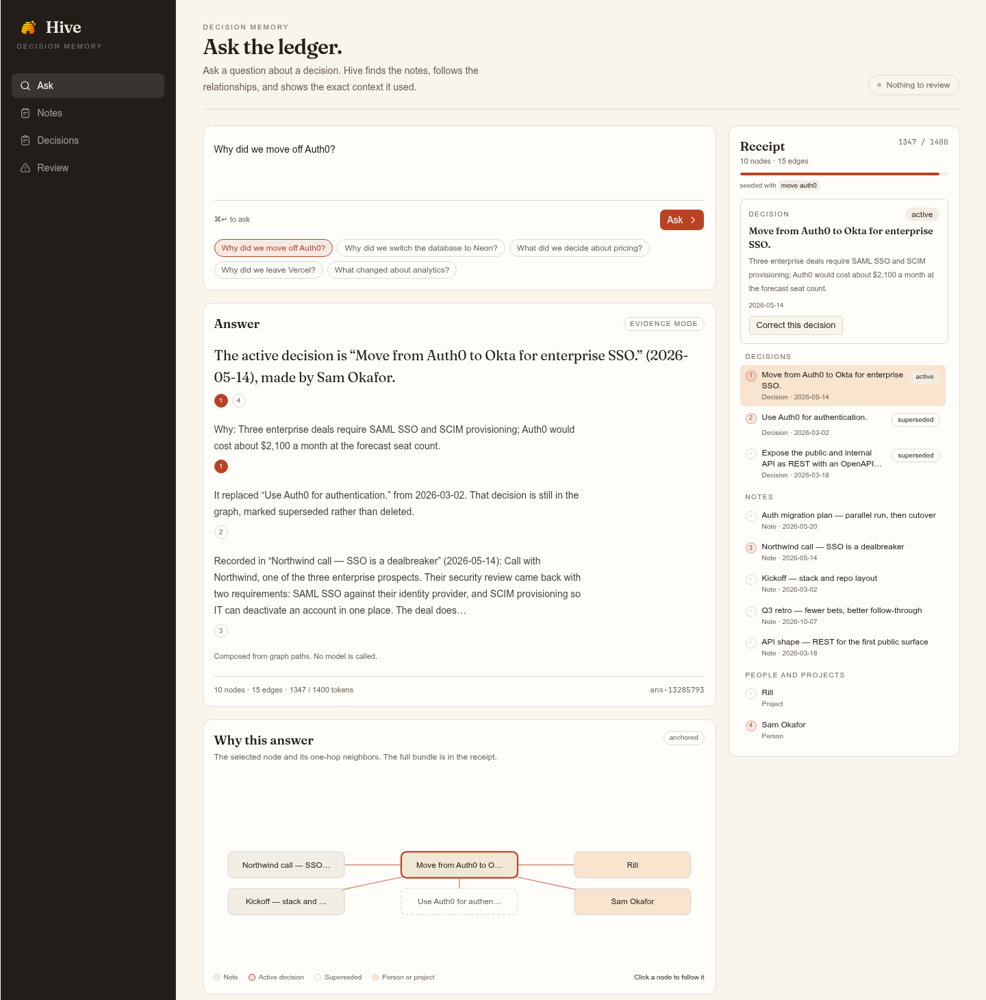
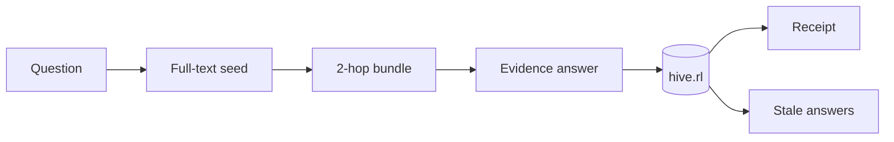
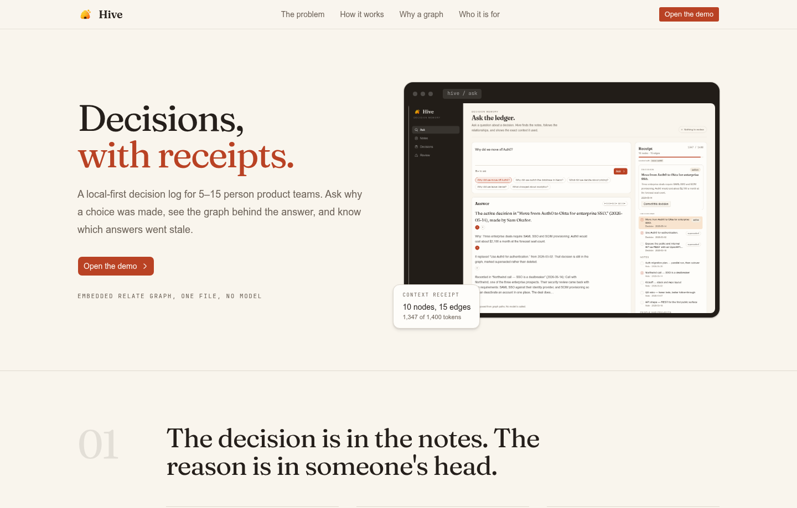

# Hive

**Ask your team's notes why. Every answer comes with the graph it used.**

Hive is a local-first answer engine over a small team's notes and decisions. You ask a question, it finds the notes that match, follows two hops to the decisions, people, and projects around them, and answers from that subgraph. The answer is stored with `USED` edges to the exact nodes it read, so you can ask later which answers relied on a decision you have since corrected.

Built for the [Relate by Neo4j Hackathon](https://relate.devpost.com/) — theme: _Context, connected_.



## The workspace

Hive is not a read-only demo. The seed gives you a team to explore, and the app writes to the same graph:

- **Ask** — a question, an answer, and the receipt behind it.
- **Notes** — add a note, choose the author and projects, and optionally record a decision in the same step.
- **Decisions** — add a decision with a source note, or correct an active one. The old decision stays.
- **Review** — answers that asserted a decision which has since been superseded.

People and projects can be added from the Notes page. Every write goes to `data/run/hive.rl`; the committed seed stays untouched.

## Use case

A six-person product team keeps its decisions in meeting notes. Six months later nobody remembers why the team moved off Auth0, which decision replaced the original pricing model, or whether the answer someone got last week is still true.

A vector store can find the five notes that mention Auth0. It cannot answer:

- **"Why did we move off Auth0?"** — the reason lives on a `Decision` node, connected to the meeting that made it and the person who decided.
- **"What did we decide about pricing?"** — the current answer is the newest node in a `SUPERSEDES` chain, not the note that mentions pricing most often.
- **"Which answers relied on the decision I just corrected?"** — this is a reverse traversal from `Answer` to `Decision`. There is no chunk to search; the relationship is the record.

Hive makes those three questions the product.

The seed data is a fictional company, **Rill**, with 18 notes, 18 decisions, 6 people, and 4 projects across eight months. It is synthetic and committed to the repository so the demo is reproducible.

## How it uses Relate

- **Mode:** single file (`data/seed/hive.rl`, copied to `data/run/hive.rl` on first boot).
- **Why this mode:** the whole graph is 46 nodes and 124 relationships. A single `.rl` file is the cleanest thing to commit, copy, and hand to a judge. It also makes the demo honest: the store in the repository is the store the app reads.
- **What the graph models:**

```cypher
(:Note     {id, title, body, date, path})
(:Person   {id, name})
(:Project  {id, name})
(:Decision {id, text, date, status, reason, validFrom, validTo})
(:Answer   {id, question, text, at, mode})

(:Note)-[:AUTHORED_BY]->(:Person)
(:Note)-[:MENTIONS]->(:Project)
(:Note)-[:STATES]->(:Decision)
(:Note)-[:CONTEXT_FOR]->(:Decision)
(:Decision)-[:DECIDED_BY]->(:Person)
(:Decision)-[:ABOUT]->(:Project)
(:Decision)-[:SUPERSEDES]->(:Decision)
(:Answer)-[:USED]->(:Note|:Decision|:Person|:Project)
(:Answer)-[:ANSWERED_WITH]->(:Decision)
```

`ANSWERED_WITH` is the decision the answer asserted; `USED` is everything it read. That distinction is what makes the stale-answer query precise: an answer is stale only when the decision it asserted has been superseded, not when it merely mentioned an old decision as context.

## Setup and run

Requires **Bun 1.4+**. No database server, no API key, no model.

```bash
bun install
bun run hive:seed     # builds data/seed/hive.rl from data/seed/notes/*.md
bun dev
```

Open the URL Vite prints. `/` is the landing page; `/hive` is the app (usually <http://localhost:3000/hive>).

The first request copies `data/seed/hive.rl` to `data/run/hive.rl`. Answers and corrections are written there. To start over:

```bash
# stop the dev server first: one process writes a store at a time
bun run hive:seed
```

### Without the UI

```bash
bun run hive:ask "Why did we move off Auth0?"
bun run hive:inspect
bun run test
```

`hive:ask` writes to `data/run/hive.rl`, so stop the dev server before using it.

### With the Relate CLI

```bash
relate -d ./data/seed/hive.rl --read-only --mode table \
  "MATCH (d:Decision {status: 'superseded'}) RETURN d.id, d.text, d.validTo"
```

The seed store is never written by the app, so it can be opened read-only while the app runs. To inspect the live store, copy it first:

```bash
cp data/run/hive.rl /tmp/hive.rl
relate -d /tmp/hive.rl --read-only --mode table \
  "MATCH (a:Answer)-[:ANSWERED_WITH]->(d:Decision) RETURN a.question, d.status, d.text"
```

## Where the data lives

| Path                   | What it is                                                                                                          |
| ---------------------- | ------------------------------------------------------------------------------------------------------------------- |
| `data/seed/notes/*.md` | The source of truth: 18 markdown notes with frontmatter.                                                            |
| `data/seed/hive.rl`    | The committed Relate store, built deterministically from the notes.                                                 |
| `data/run/hive.rl`     | The working store, created on first request. Gitignored. Holds answers, corrections, and anything added in the app. |

`bun run hive:seed` deletes and rebuilds `data/seed/hive.rl`, and removes `data/run/hive.rl` so the next boot starts from the seed.

## How an answer is built



1. **Seed.** The question is reduced to search terms and run against Relate's full-text index (`CREATE FULLTEXT INDEX note_text ...`). BM25 returns up to five notes. If the combined query is too strict, each term is searched separately and the scores are merged.
2. **Expand.** Two breadth-first hops from the seed notes, using `MATCH (a)-[r]-(b) WHERE a.id IN $ids`. The second hop is where the current version of a decision appears: the seed note states the original, and `SUPERSEDES` points forward to the active one.
3. **Budget.** Nodes are ranked by hop distance and type, with decisions weighted above notes and entities. The anchor note, the anchor decision, its replacement, the person, and the project are kept; the rest are dropped until the bundle fits 1,400 estimated tokens.
4. **Answer.** Evidence mode composes the answer from the bundle: the active decision, its reason, the decision it replaced, and the note that recorded it. No model is called, so the demo is deterministic and needs no key.
5. **Receipt.** The answer is written with `USED` edges to every node in the bundle and an `ANSWERED_WITH` edge to the asserted decision, inside one transaction.

The five queries live in [`src/lib/hive/queries.ts`](./src/lib/hive/queries.ts). The context assembly is [`src/lib/hive/context.ts`](./src/lib/hive/context.ts).

## Adding to the graph

The seed is a starting workspace, not the only data.

- **New note.** Title, body, author, and one or more projects. If the note records a decision, Hive creates the `Decision` node and the `STATES`, `DECIDED_BY`, and `ABOUT` edges in the same transaction.
- **New decision.** Decision text, reason, person, project, and an optional source note. Without a source note, Hive creates a small decision-log note so every decision still has a source.
- **New person or project.** Added from the Notes page; the next note or decision can use them immediately.

A note added in the app is immediately answerable: the full-text index is updated by Relate, and the next question can seed from it. Nothing is cached in a separate search service.

## Correcting a decision

Open a decision in the receipt and choose **Correct this decision**. The correction runs in one transaction:

- the old node gets `status: 'superseded'` and a `validTo` date;
- a new `Decision` node is created with `SUPERSEDES` pointing at the old one;
- `ABOUT`, `DECIDED_BY`, and `STATES` are copied so the new decision keeps its context;
- answers that asserted the old decision now appear under **Answers that need review**.

Nothing is deleted. The old answer is still readable, and the graph shows what changed and why.

## Demo script (2 minutes)

1. **0:00** — "A team keeps decisions in notes. Six months later, why did we choose this?"
2. **0:10** — Ask _"Why did we move off Auth0?"_ The answer names Okta, the reason, Sam, and the note. The receipt shows the nodes, the edges, and the token budget.
3. **0:35** — Click the superseded Auth0 decision in the receipt. It is still there, marked superseded.
4. **0:50** — Ask _"What did we decide about pricing?"_ The answer follows `SUPERSEDES` from the original pricing decision to the current cap.
5. **1:10** — Correct the cap from $2,000 to $2,500. The old decision stays; the new one replaces it.
6. **1:30** — The previous answer moves to **Answers that need review**, because it asserted the decision that just changed.
7. **1:45** — Show the store in the terminal with `relate` or `bun run hive:inspect`.
8. **1:55** — Close: "The graph is the context, and the receipt is the proof."

Optional 15 seconds, if you want to show the write side: open **Notes**, add a note with a decision, then ask about it on **Ask**. It is answerable immediately.

## Relate features used

- Embedded Node.js client (`@relate/relate`), no server process.
- Single-file store.
- Cypher traversal, including variable-depth supersession chains in the seed.
- Full-text index and `SEARCH ... SCORE AS` (BM25).
- Explicit transactions for notes, decisions, answers, and corrections.
- The `relate` CLI for inspection.

Not used: vector indexes, MCP, Bolt/HTTP, WebAssembly. They are good fits for later; the demo is deliberately one complete loop.

## What is deliberately not here

- **No LLM.** The answer is composed from graph paths. The trade-off is fluent prose; the gain is a deterministic demo with no key, no model download, and no hallucinated citation. The receipt is the part that matters.
- **No bulk import.** Notes are added in the app or seeded from markdown with frontmatter. A Slack or email importer is the next step.
- **No auth or multi-user.** One writer, one store, one person — which is exactly Relate's shape.

## Landing page

The marketing page at `/` explains the problem, the graph, and who the product is for. It links into the app at `/hive`.



## Project layout

```
data/seed/notes/                18 source notes
data/seed/hive.rl               committed store
scripts/hive-seed.ts            markdown -> Cypher
scripts/hive-ask.ts             terminal demo
scripts/hive-inspect.ts         graph summary
src/lib/hive/                   db, queries, context, answer, library, correction
src/routes/index.tsx            landing page
src/components/landing/         landing mark, demo graph
src/routes/api/hive/            ask, overview, library, notes, decisions, correct
src/routes/(dashboard)/hive/    layout, ask, notes, decisions, review
src/components/hive/            shell, answer, receipt, graph, dialogs
```

## Origin

Hive extends a private TanStack Start starter that predates the contest (auth, Drizzle, oRPC scaffolding). The Hive feature — seed corpus, graph schema, context assembly, evidence answer, receipt UI, correction flow — was written during the contest period. The starter's todo demo is replaced by a redirect to `/hive`.

## License

MIT. See [LICENSE](./LICENSE).
